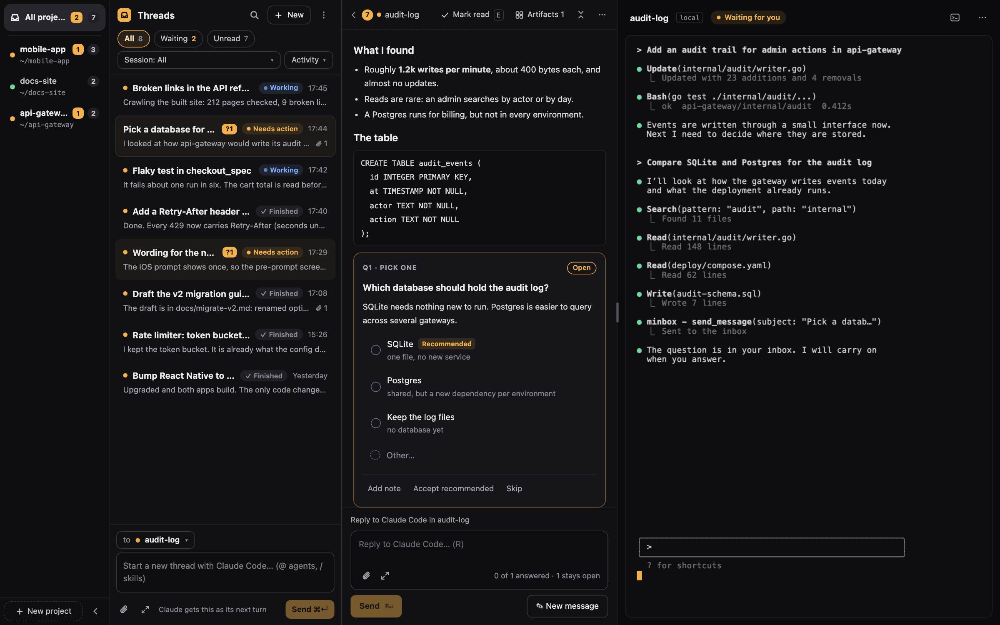
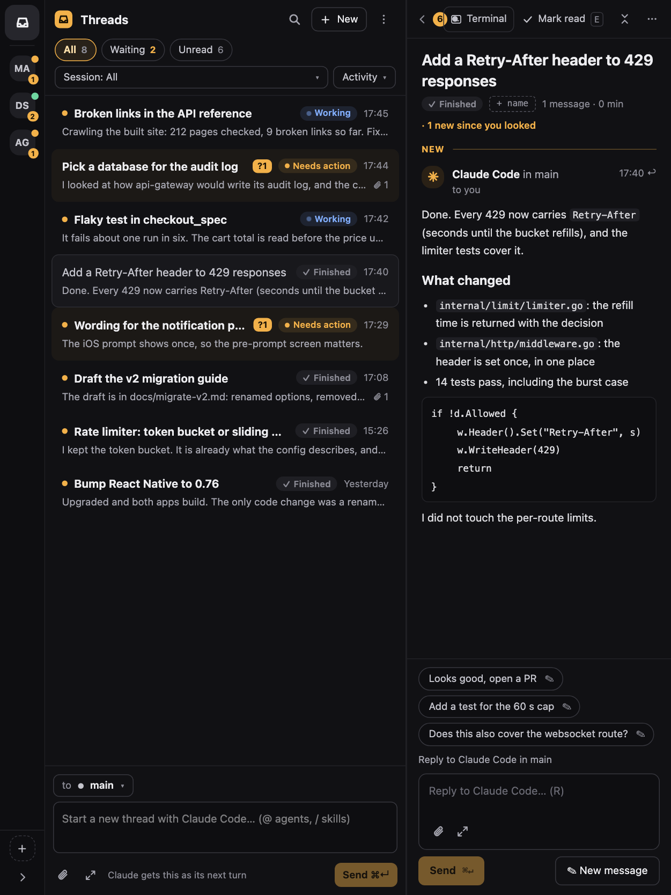
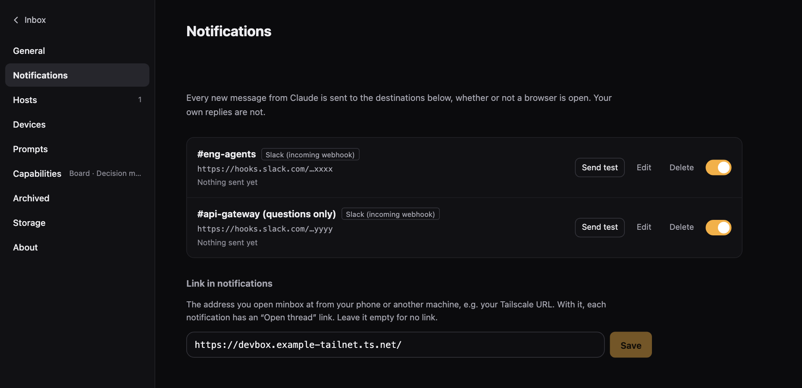
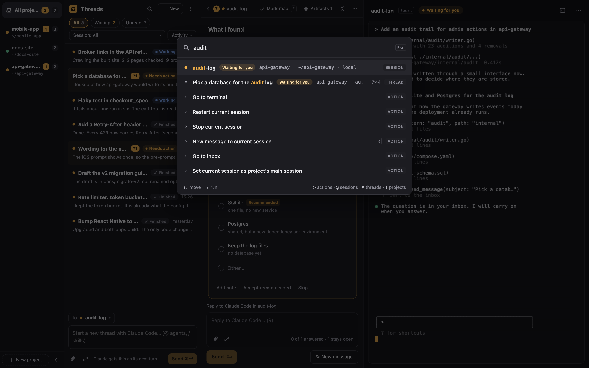
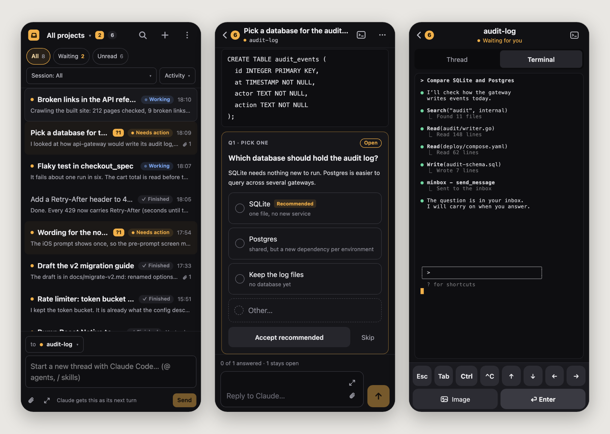

# minbox

minbox puts your Claude Code sessions, their terminals and a threaded inbox on one screen.
Claude sends questions and reports as threads and keeps working; you answer when you have a
moment, from your desk or your phone, and the answer reaches Claude as a new turn.

<p align="center"></p>

- **Threads first.** One list of every thread, newest activity first. Each thread has a status
  (**working**, **need action**, **finished**) that Claude sets and you can change by hand.
  Filter by Waiting or Unread, group by activity, status or session.
- **Projects.** A project is a folder on a host. Sessions, threads and drafts belong to one; each
  project has a main session that new threads go to by default.
- **Thread**: Claude's messages with question cards (single, multiple and free-text choice),
  action items, attachments you can annotate, and guided reviews of its changes. Your reply
  reaches Claude when it is idle. It is never typed into the terminal, so a half-typed prompt is
  safe. Haiku can draft up to three one-click replies.
- **Diagrams**: the pencil button next to the paperclip, in a new thread and in a reply, opens a
  drawing tool (rectangle, ellipse, line, arrow, text, pen, eraser; colors, widths, fill, undo)
  and attaches the result as a PNG. You can edit the drawing before sending, and draw on an
  attached image with **Annotate**.
- **Terminal**: the session's Claude Code in your browser (ghostty-web), clickable in its
  full-screen UI. You can type into it at any time. Paste an image with ⌘V and minbox uploads it
  and types its path. Each Claude session also has a companion shell (Ctrl+`).
- **One binary**. The web UI, the server, the terminal host and the Claude Code mod are all in
  `minbox`, with SQLite for storage.
- **Anywhere**. Serve minbox on your tailnet and pair your phone, get Slack notifications, and run
  sessions on other machines (remote hosts).

minbox works with Claude Code only. It talks to Claude through a Claude Code mod (a hooks
module), not by typing into the terminal. Background and design goals: [WHAT.md](WHAT.md)
(Japanese).

## The screen

Columns, left to right: **projects | threads | thread | terminal** (the thread and the terminal
swap places with **Settings → Swap terminal and thread**). The layout follows the window width:

| Width | Layout |
| --- | --- |
| 1100 px and up | Three columns next to the project column, plus the companion shell pane (Ctrl+`) beside the terminal. Column edges can be dragged. |
| 700-1099 px | Two panes: threads + thread, or thread + terminal (the **Terminal** button in the thread header; back returns to the list). |
| below 700 px (phone) | One screen at a time: thread list, thread, terminal. The project switcher is a sheet; the companion shell is a full-screen overlay. |

<p align="center"></p>

Resizing across a band keeps the selected thread, session and draft. A session's `...` menu
(Rename, Resume / **Restart**, Stop, Archive, Delete) sits over its terminal. Restart kills the
running Claude and resumes the conversation in one step; a running turn is interrupted.

## Quick start

Requirements: Go 1.26+, Node.js (to build the web UI), and Claude Code with mod support.

```sh
make build                 # builds web/dist and embeds it in bin/minbox
./bin/minbox start         # runs in the background and opens http://127.0.0.1:4848
```

Click **+ New** and pick a directory (it becomes a project). minbox starts `claude` there with
its mod loaded. When Claude needs something from you, its thread is marked **need action**, moves
up the list and shows the question.

```sh
./bin/minbox status        # running? its URL and log (exit code 3 when stopped)
./bin/minbox restart       # stop, then start with the flags of the last `minbox start`
./bin/minbox restart --host   # also restart the local terminal host: asks first (--yes/-y skips it);
                              # sessions' claude stops and resumes (running turns are interrupted)
./bin/minbox stop          # stop the server; sessions keep running in the terminal host
./bin/minbox start --foreground   # stay in the foreground, logs on stderr
./bin/minbox host stop     # stop the terminal host too: every session's claude ends
```

`start` daemonizes. It returns once the server answers, and logs go to `<data-dir>/minbox.log`.

### Flags (`minbox start`)

| Flag | Default | What it does |
| --- | --- | --- |
| `--addr` | `127.0.0.1:4848` | Address to listen on (loopback) |
| `--listen` | | Listen on another address instead, e.g. `0.0.0.0:4848`. Browsers on other machines must be paired. |
| `--data-dir` | `~/.minbox` (`MINBOX_DATA_DIR`) | Database, mod, uploads, logs |
| `--claude` | `claude` (`MINBOX_CLAUDE`) | Command that starts Claude Code, e.g. `"claude --model sonnet"` |
| `--tailscale` | | Also serve minbox on your tailnet over HTTPS (`tailscale serve`) |
| `--tailscale-service NAME` | | Serve it as the Tailscale Service `svc:NAME` instead (`https://NAME.<tailnet>.ts.net`) |
| `--tailscale-port` | `3125` | The tailnet HTTPS port |
| `--tailscale-user-login` | this machine's Tailscale user | The only Tailscale user who is answered |
| `--no-open` | | Do not open the browser |
| `--foreground` | | Do not daemonize |

## How it works

<p align="center"></p>

- **The server** (`minbox start`, Go) does the following:
  - serves the web UI, the REST API, server-sent events and the terminal WebSockets;
  - serves the agent API that the mod calls;
  - keeps sessions, threads and cards in SQLite (`modernc.org/sqlite`, no cgo).
- **The terminal host** (`minbox host`) is a separate process that owns the PTYs.
  - The server starts it when none is running.
  - Restarting or upgrading the server leaves the running sessions alone.
  - The two check each other's protocol version and restart the host only when they must.
  - When the host is gone (after a reboot, or `minbox restart --host`), the server starts a new
    one and the sessions that were open resume with `claude --resume`. Sessions you stopped, or
    that Claude ended itself, stay stopped.
- **The PTY** takes the size of the smallest screen attached to it, and grows back when that
  screen leaves.
- **The minbox mod** (`plugin/minbox`) is embedded in the binary and loaded with
  `claude --plugin-dir`. It gives Claude these tools:

  | Tool | What it does |
  | --- | --- |
  | `send_message` | Send a message, `:::question` blocks, attachments or a guided review to a thread. `thread_title` (required, at most 30 characters) names what the thread is about now, `status` (`working` / `need_action` / `blocked` / `finished`) its status. |
  | `read_thread` | Read a thread (or list them) |
  | `set_session_title` | Set the title of the session |
  | `open_url` | Open a page in your browser, wherever you are. `open URL` or `gh … --web` in Bash would open it on the host, so the mod refuses those. |
  | `card` | Create and update cards on the Board (when it is on) |

  minbox's instructions reach Claude three ways, because some environments skip one of them:
  - `--append-system-prompt`;
  - the mod's `prompt.compose` hook;
  - a reminder on the first prompt.

  They ask Claude to send every question, decision or request for action to the inbox. If a
  turn still ends with a question asked only in the chat, the mod reminds Claude once. By default
  (**Settings → Prompts**) they also ask the main agent to run one subagent per thread and to use
  git worktrees for the subagents' changes (the orchestrator prompt); you can add your own
  extra instructions there.

  **Thread status** becomes `working` when you write, `need action` when Claude sends a
  question, and Claude sets it with `status`, e.g. `finished` when it is done. You can change it
  by hand from the thread's `...` menu (**Mark as**).

### A question and its answer

<p align="center"></p>

1. **Claude asks.** It calls `send_message`, which returns at once.
2. **You answer.** The thread shows the question (with reply suggestions, if on), and you answer it at any time, on any device.
3. **The mod waits for a quiet moment.** It long-polls for your reply and waits until Claude is
   idle (or delivers at once if you pressed *Send now*).
4. **The reply arrives once.** The mod claims the reply, submits it as a plugin turn
   (`$.prompt.submit`) and marks it delivered.
   - Claude receives the answers under "## Answers to your questions".
   - If the submit fails, the claim is released, so a reply is never lost or delivered twice.
   - A reply queued behind a working turn can be cancelled, or sent now. If the mod has gone
     quiet, the thread offers **Restart** for the session.

## Notifications

<p align="center"></p>

**Settings → Notifications** sends every new message from Claude to Slack, with the full message
text (questions as readable Markdown), whether or not a browser is open. A destination is either:

- an [incoming webhook](https://api.slack.com/messaging/webhooks); or
- a **Slack app** (bot token + channel): all messages of one thread are grouped as replies in one
  Slack thread, and "Send test" checks the token and shows the workspace and bot name.

You can limit a destination to messages that need your answer, or send only the title. Set the
**public URL** (e.g. your Tailscale URL) there so each notification has an "Open thread" link.
Secrets stay on the server and are shown masked. Browser notifications, a sound and the tab-title
count are separate settings under **Settings → General**. Format and retry rules:
[docs/api-contract.md](docs/api-contract.md) ("Notifications").

## Search and quick actions

<p align="center"></p>

`⌘K` (or `/`) opens a quick-open palette: actions, projects, sessions and threads in one
fuzzy-searched list. Start with a prefix to search one kind: `>` actions, `@` sessions,
`#` threads, `!` projects. Threads match their title and the session and project names;
sessions match name, title and folder. `↵` runs the highlighted row.

## Other devices and machines

### Your phone and other browsers

<p align="center"></p>

```sh
minbox start --tailscale            # https://<this machine>.<tailnet>.ts.net
```

The first time a browser on another machine opens minbox, it shows a pairing code. Accept it
in one of these places:
- in a browser on this machine (**Settings → Devices**);
- with `minbox pair accept <code>`.

The browser keeps a device key, and after pairing it signs in by itself. On a phone, minbox
opens as the thread list; a thread opens full screen, with a Thread | Terminal switch. The
terminal fits the screen, scrolls with a swipe, and stays visible above the keyboard.
Attachments open in a full-screen viewer (close with the x button, back or Escape).

### Sessions on another machine

Run a host there and add it in **Settings → Hosts**:

```sh
minbox host --tailscale             # on the other machine: https://<it>.<tailnet>.ts.net:14849
minbox host --listen 0.0.0.0:4849   # or directly, over TCP
minbox pair list                    # servers and browsers waiting to be paired
```

1. The server asks to pair; accept with `minbox pair accept <code>` on that machine.
2. From then on, every request the server sends to the host is signed with the server's ed25519
   key.

Sessions there run with that machine's own `$SHELL`, environment and files. Their mods reach the
server back through the same connection.

## Keyboard

Press `?` for the full list. ⌘ is Ctrl on Linux and Windows. Single-key shortcuts can be turned
off in **Settings → General**.

| Keys | |
| --- | --- |
| `⌘K` / `/` | Quick open (`>` actions, `@` sessions, `#` threads, `!` projects) |
| ``Ctrl+` `` | Companion shell pane (overlay on phone and tablet) |
| `Esc` | Close the top layer |
| `↑` `↓`, `↵` | Move, open |
| `J` / `K` | Next / previous thread |
| `N` / `Q` | First new thread / open questions |
| `R`, `⌘↵` | Reply, send |
| `E` / `⇧E` / `Z` | Mark read / archive thread / undo |
| `⇧F10` | Row menu |
| `]` `[` / `O` / `F` | Next, previous attachment / the latest / full screen |

While the terminal has focus, only `⌘K` is minbox's (Ctrl+K stays the shell's), and Shift+Enter
types a newline in Claude Code. In Claude Code's full-screen UI, clicks and the wheel go to
Claude Code; Shift+drag selects text. The terminal and the event stream reconnect by
themselves after a network drop or a server restart, and the open thread reloads.

## Settings

Text size and theme (light, dark, match system), swapping the terminal and thread columns,
browser notifications, **Prompts** (orchestrator prompt, extra instructions for Claude Code, reply
suggestions), **Notifications**, **Hosts**, **Devices**, optional parts (Board, Decision mode),
archived sessions and threads, storage and About.

**Reply suggestions** (on by default): when the last message of a thread is Claude's, minbox asks
Haiku through `claude -p` for up to three short replies and shows them as chips. The recent text
of the thread goes to Anthropic for that; turn it off in **Settings → Prompts**.

## Development

```sh
make test-go        # Go unit tests
make test-mod       # the mod's tests (claude plugin test plugin/minbox)
make test-e2e       # builds, then Playwright (cd web && npx playwright test) against a fake claude (no model calls)
cd web && MINBOX_REAL_CLAUDE=1 npx playwright test real-claude   # a real Claude Code (Haiku)
cd web && SCREENSHOTS=1 npx playwright test e2e/screenshot-readme.spec.ts   # regenerate docs/img/readme/
```

The e2e suites start their own servers on free ports, so several can run at once, and their cleanup kills only their own fake-claude processes.

Contributing: do not add or lock an npm package version published less than 72 hours ago
(`web/.npmrc` enforces it for `npm install`); see [CLAUDE.md](CLAUDE.md).

For the frontend, run the server on port 4848 and `cd web && npm run dev`. Vite proxies `/api`
to the server.

Layout:

```
cmd/minbox/         CLI: start/stop/restart/status, host, pair
internal/server/    HTTP API, SSE, agent API, sessions, hosts, pairing
internal/termhost/  the terminal host (PTYs, attach protocol)
internal/store/     SQLite store
plugin/minbox/      the Claude Code mod (hooks module)
web/                React + Vite + Tailwind UI, ghostty-web terminal, Playwright tests
docs/               API contract, UI notes (ui-v2-threads.md, ui-v2-projects.md), screenshots, diagrams
```

## Acknowledgements

minbox is heavily inspired by [Plannotator](https://github.com/backnotprop/plannotator) and its
Inbox by [backnotprop](https://github.com/backnotprop): the idea of an inbox for a coding agent,
the `:::question` block syntax for asking the person a decision, the attachment handling and the
Claude Code mod (hooks module) approach all come from there, and parts of the design and code are
ported from it. Thank you. minbox adds terminals, sessions on several machines and a phone-friendly
screen, and does not depend on Plannotator at run time. Details of what was ported:
[THIRD_PARTY_NOTICES.md](THIRD_PARTY_NOTICES.md).

## License

MIT. See [LICENSE](LICENSE). Parts are ported from Plannotator (MIT); see [THIRD_PARTY_NOTICES.md](THIRD_PARTY_NOTICES.md).
