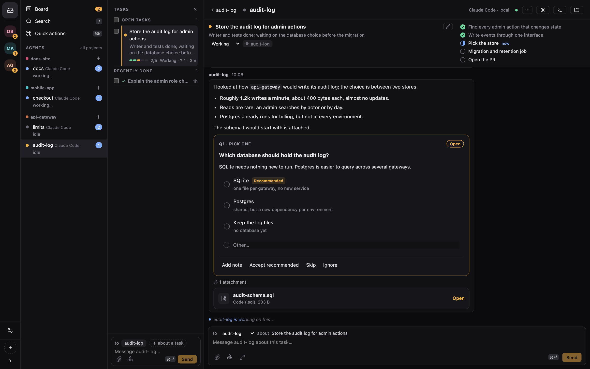
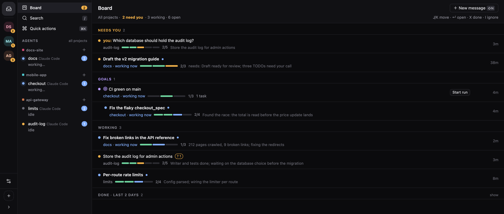
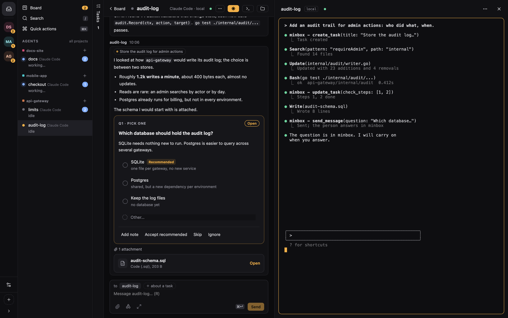
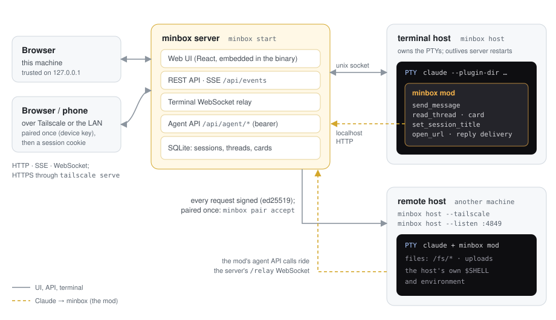
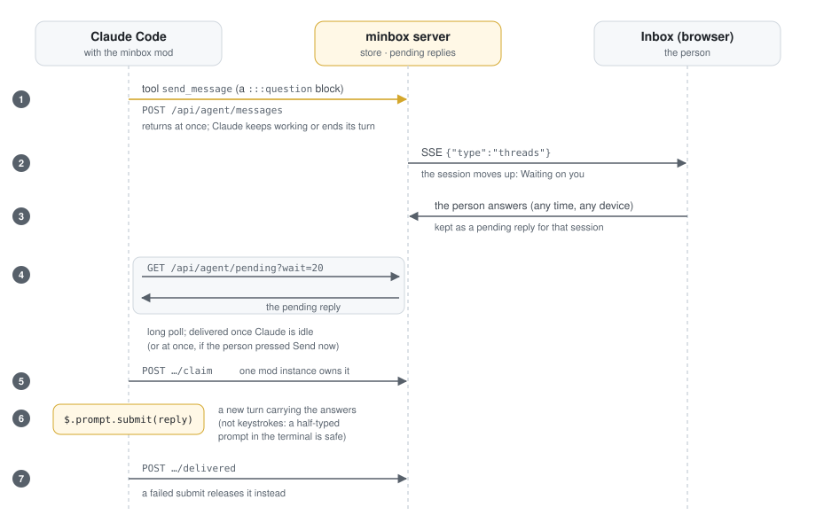
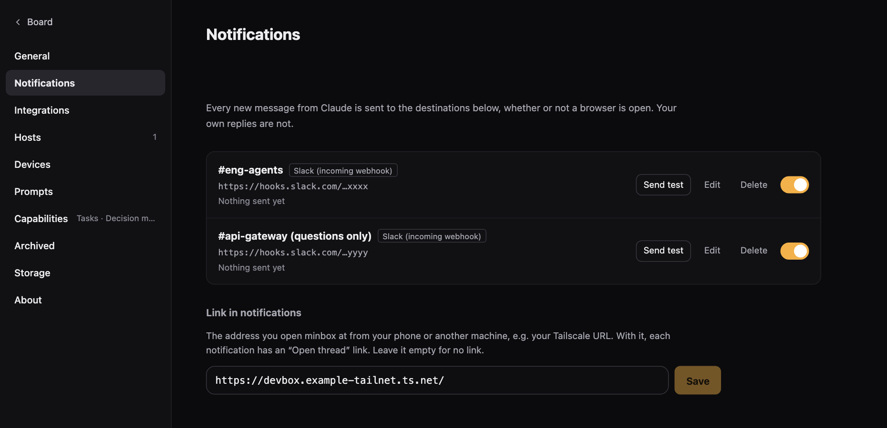
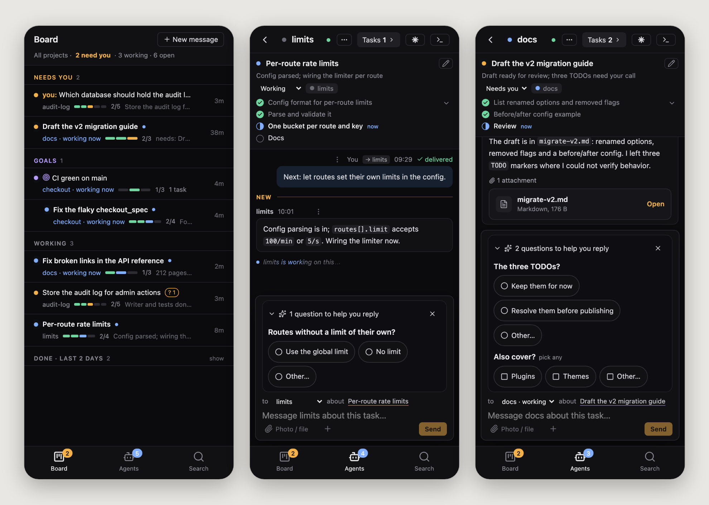

# minbox

minbox puts your coding agents (Claude Code, Pi, OpenCode), their terminals and the work they do on one screen.
You talk to each agent in one running conversation, its **stream**; the agent keeps a **task** for each piece of
work, with a checklist it ticks as it goes; and when it needs a decision it asks a **question** and keeps working.
You answer when you have a moment, from your desk or your phone, and the answer reaches the agent as a new turn.

<p align="center"></p>

- **One stream per agent.** Each agent (a Claude Code, Pi or OpenCode session in a project folder) has one
  conversation, like a chat with a colleague. Write to it; there is no thread to pick first.
- **Tasks.** Every message belongs to exactly one task. The agent creates and updates tasks itself with its
  `create_task` / `update_task` tools: a title, a one-line summary of where it stands, a status (working, needs you,
  blocked, done) and a checklist. A quick question gets a small task of its own, done at once.
- **The Board.** Home is the Board across all agents and projects: what **needs you** (questions and tasks waiting on
  you), **goals**, what is **working**, what went quiet, and what was done in the last two days.
- **Questions.** An agent writes a `:::question` block (pick one, pick any, or free text, with a recommended
  answer). It shows on the Board under NEEDS YOU; you answer with a click or a tap in the agent's page. The reply
  never goes through the terminal, so a half-typed prompt there is safe.
- **Goals.** An outcome with *done when* criteria ("CI green on main"); minbox can keep the agent going, turn after
  turn, until they are met.
- **Terminal, shell and files** beside the stream, an attachment viewer you can draw on, previews of Markdown,
  HTML and Mermaid, and a phone layout.
- **One binary**, with SQLite for storage. Serve it on your tailnet and pair your phone, get Slack notifications,
  and run agents on other machines.

Background and design goals: [WHAT.md](WHAT.md) (Japanese); the v3 redesign: [docs/v3/](docs/v3/).

## The screen

<p align="center"></p>

- **Left**: the projects rail (a tile per project; ＋ adds one), then **Board**, **Search** (`/`), **Quick actions**
  (`⌘K`) and **Agents**, grouped by project, with their state (working, idle) and unread counts. The ＋ beside a
  project's name starts a new agent there.
- **Board** (home): NEEDS YOU, GOALS, WORKING, IDLE (open but quiet for more than 3 days), BLOCKED, DONE (last 2
  days, folded). `J`/`K` move, `Enter` opens the task (a question: its task, at the question), `X` marks it done (or
  reopens it), `I` ignores a question that no longer matters (the agent is not told).
- **An agent's page**: its **Tasks** pane (OPEN TASKS; RECENTLY DONE, muted; DONE THIS WEEK, folded; unread tasks in
  bold) beside its stream. Click a task to select it: the page shows its card (title, summary, status, agents, and
  the checklist, whose steps you can tick too) above the messages about it; click it again for the whole stream.
  `⇧T` folds the pane.
- **Side panes** (header buttons, or keys): the agent's **Terminal** (`T`), its companion **Shell** (``Ctrl+` ``)
  and its **Files** (`⇧F`: the folder's tree and a viewer with word wrap and full screen). Column edges can be dragged.

<p align="center"></p>

| Width | Layout |
| --- | --- |
| 1100 px and up | Sidebar, Tasks pane, stream and the side panes you open. |
| 700–1099 px | The stream with one side pane at a time. |
| below 700 px (phone) | One screen at a time, with tabs **Board · Agents · Search**. A task's checklist folds to a progress bar under its title; the terminal, shell, files and tasks open as sheets. |

## Install

minbox is one binary. The web UI, the Claude Code mod, the Pi extension and the OpenCode plugin are
embedded in it; at start it writes the mod and the extensions to private, versioned folders in its data
directory (`~/.minbox/plugin/<hash>/`, `pi-extension/<hash>/`, `opencode-plugin/<hash>/`) and passes them to
each agent it starts (`claude --plugin-dir`, `pi -e`, OpenCode's `OPENCODE_CONFIG_CONTENT`). There is
nothing else to install: no `claude plugin install`, no marketplace, nothing next to the binary.

You also need a coding agent on `PATH`: Claude Code with mod support, Pi 1.x (Node 22.19+) or OpenCode 2.x.
With several installed the New agent dialog lets you pick; with one it just uses that one.

### From a release (macOS, Linux; arm64, amd64)

Pick a version on the [Releases](https://github.com/ryotarai/minbox/releases) page, then:

```sh
version=v0.1.0   # the release to install
os=$(uname -s | tr '[:upper:]' '[:lower:]')                              # darwin or linux
arch=$(uname -m); case "$arch" in x86_64) arch=amd64;; aarch64) arch=arm64;; esac
name=minbox_${version#v}_${os}_${arch}
base=https://github.com/ryotarai/minbox/releases/download/$version
curl -fL -O "$base/$name.tar.gz" -O "$base/checksums.txt"
grep " $name.tar.gz\$" checksums.txt | shasum -a 256 -c   # or: sha256sum -c
tar xzf "$name.tar.gz"
mkdir -p ~/.local/bin && install -m 755 "$name/minbox" ~/.local/bin/minbox   # any folder on PATH
```

On macOS the binary is not signed or notarized. `curl` does not mark it as downloaded, but if you
fetched the archive with a browser, Gatekeeper refuses to run it; clear the mark with
`xattr -d com.apple.quarantine ~/.local/bin/minbox`.

To upgrade, install the new binary over the old one and run `minbox restart` (see **Settings → Hosts**
for the terminal host).

### From source

Requirements: Go 1.26+ and Node.js 22.12+ (to build the web UI).

```sh
make build                 # builds web/dist and embeds it in bin/minbox
```

The result is the same single binary, `bin/minbox`. While working on the mod or the extensions,
`MINBOX_PLUGIN_SOURCE=$PWD/plugin ./bin/minbox start` makes minbox use the live `plugin/` folder
instead of the copies embedded at build time.

## Quick start

```sh
minbox start               # runs in the background and opens http://127.0.0.1:4848
```

The first time, the browser asks to pair (every browser pairs once, one on this machine too):
press **Pair this browser**, then run the command it shows in a terminal on this machine:

```sh
minbox pair accept 482-913   # shows the browser and its key, asks Accept it? [y/N]
```

The page goes on by itself. Upgrading from a version that trusted any browser on 127.0.0.1:
your browser shows that screen once; do the same.

Add a project (the ＋ at the bottom of the projects rail, or **Start one in a folder…**) and start an agent in it:
minbox starts `claude` there with its mod loaded. Then write to it in its stream, or press `⇧N` anywhere: with a
project selected, **Let minbox choose** sends the message to the agent whose work fits (a helper model picks among
the project's running agents) or to a new one. The agent puts the request in a task, and when it needs you, the
question shows on the Board under NEEDS YOU.

```sh
minbox status              # running? its URL and log (exit code 3 when stopped)
minbox restart             # stop, then start with the flags of the last `minbox start`
minbox restart --host         # also restart the local terminal host: asks first (--yes/-y skips it);
                              # agents stop and resume (running turns are interrupted)
minbox stop                # stop the server; agents keep running in the terminal host
minbox start --foreground         # stay in the foreground, logs on stderr
minbox host stop           # stop the terminal host too: every agent ends
```

**Settings → Hosts** shows the local terminal host's version, pid and start time, and marks it
**Outdated** when it runs another build than the server (after `make build` and a plain
`minbox restart`). Its **Restart** button does what `minbox restart --host` does without stopping
the server: it lists the agents and shells whose processes will end, then starts a new host from the current
binary; the agents resume (or, if you untick that, end).

`start` daemonizes. It returns once the server answers, and logs go to `<data-dir>/minbox.log`.

### Flags (`minbox start`)

| Flag | Default | What it does |
| --- | --- | --- |
| `--addr` | `127.0.0.1:4848` | Address to listen on (loopback) |
| `--listen` | | Listen on another address instead, e.g. `0.0.0.0:4848`. Browsers on other machines must be paired. |
| `--data-dir` | `~/.minbox` (`MINBOX_DATA_DIR`) | Database, mod, uploads, logs |
| `--claude` | `claude` (`MINBOX_CLAUDE`) | Command that starts Claude Code, e.g. `"claude --model sonnet"` |
| `--pi` | `pi` (`MINBOX_PI`) | Command that starts Pi, e.g. `"pi --model anthropic/sonnet:high"`. Pi is offered only if this is on `PATH`. The model/provider are Pi's own configuration |
| `--opencode` | `opencode` (`MINBOX_OPENCODE`) | Command that starts OpenCode 2.x, e.g. `"opencode --model anthropic/claude-sonnet-4-5"`. Offered only if it is on `PATH` and `--version` says 2.x. Login, models and sessions are OpenCode's own |
| `--tailscale` | | Also serve minbox on your tailnet over HTTPS (`tailscale serve`) |
| `--tailscale-service NAME` | | Serve it as the Tailscale Service `svc:NAME` instead (`https://NAME.<tailnet>.ts.net`) |
| `--tailscale-port` | `3125` | The tailnet HTTPS port |
| `--tailscale-user-login` | this machine's Tailscale user | The only Tailscale user who is answered |
| `--no-open` | | Do not open the browser |
| `--foreground` | | Do not daemonize |

## Working with agents

- **Writing.** The reply box at the bottom of an agent's page shows `to: <agent>` and, with a task selected,
  `about: <task>`. Without a task the agent decides: an open task the message is about, or new work (a new task).
  `⌘↵` sends. A message reaches the agent when it is idle; one queued behind a working turn can be cancelled or
  sent now.
- **Moving a message.** A message's `⋯` menu: **Reply**, **Copy text**, **Move to another task…** (an agent reply takes
  the message it answered along; a task left empty by mistake is removed), **Mark unread from here**, and **Start new
  thread from here** (hand the message to another agent or a new one; [docs/thread-fork.md](docs/thread-fork.md)).
- **Answering.** Question cards take a click per choice, **Other…** for your own words, **Add note**, **Accept
  recommended**, **Skip** or **Ignore**. The answer is about the question's task, and the agent gets it under
  "## Answers to your questions". Agents also send `:::actions` checklists for things only you can do.
- **Help me reply** (on by default): when the agent's message is the last one, a helper model drafts a few questions
  with options that help you decide your reply; what you pick is added to your message as `Q: … → A: …` lines.
- **Commands**: a message that starts with `!` runs as a shell command in the agent's folder (60 s limit); the result
  shows in the stream and goes to the agent at once. See [docs/thread-commands.md](docs/thread-commands.md).
- **Commands the agent asks to run**: an agent can send shell commands with its message; each shows with **Allow** and
  **Deny** (and **Allow all** / **Deny all**). Allowed ones run on the agent's host, the card shows the exit code and the
  output, and the results go back to the agent. See [docs/agent-commands.md](docs/agent-commands.md).
- **Attachments**: paste (`⌘V`), drop, or the attach button (on a phone, photo or file). Type `@` for a popup of the
  agent's files and folders. The draw button opens a sketcher (shapes, arrows, text, pen; **Done** attaches a PNG),
  and the pencil on an attached image draws on top of it.
- **What agents send** shows in place: Markdown with code, tables and Mermaid diagrams, images, and file attachments
  that open in a viewer (Markdown and HTML previews, code, PDFs). You can draw on an image and comment on a spot of
  it, a moment of a video or a passage of a document; your notes go to the agent with your next message. Agents can also send a **guided review** of their
  changes, section by section.
- **Goals**: when you ask for an outcome ("keep fixing until CI is green"), the agent may make a goal with *done when*
  criteria and tasks under it. The Board shows it under GOALS with **Start run** / **Pause** / **Stop**: while a run
  is on, minbox continues the agent after each turn until the criteria are met; a question from the run waits for you.
- **Search** (`/`): tasks (title, steps, summary) and messages, with the match marked. **Quick actions** (`⌘K`): one
  fuzzy list of actions, agents, tasks and projects (`>` actions, `@` agents, `#` tasks, `!` projects).
- **The agent's menu** (`⋯` in its header, or right-click / long-press its row): Rename, **Restart** (kills the
  running agent and resumes its conversation in one step) or Resume, Stop, Archive, Delete.
- **Terminal**: the agent's own Claude Code (or Pi, OpenCode) in the browser (ghostty-web), clickable in its
  full-screen UI. You can type into it at any time; paste an image with `⌘V` and minbox uploads it and types its path.

## Keyboard

Press `?` for the full list. ⌘ is Ctrl on Linux and Windows. Single-key shortcuts can be turned
off in **Settings → General**.

| Keys | |
| --- | --- |
| `⌘K` | Quick actions (`>` actions, `@` agents, `#` tasks, `!` projects) |
| `⇧N` | New message (minbox picks the agent by default) |
| `/` | Search |
| `g b` · `g a` | Board · first agent |
| `J` / `K`, `Enter` | Move on the Board, open the task (at the question) |
| `X` · `I` | Done / reopen the focused task · ignore the focused question |
| `E` · `F2` | Rename the task |
| `N` | Next agent with unread messages |
| `R`, `⌘↵` | Reply (quotes the selected text), send |
| `T` · ``Ctrl+` `` · `⇧F` · `⇧T` | Terminal · shell · files · Tasks pane of the agent |
| `Z` | Undo the last action |
| `⇧D` | Decision mode: every waiting question, one at a time, `1`–`9` to pick (when on in Settings) |
| `Esc` | Close / back |

While the terminal has focus, only `⌘K` is minbox's (Ctrl+K stays the shell's), and Shift+Enter
types a newline in Claude Code. In Claude Code's full-screen UI, clicks and the wheel go to
Claude Code; Shift+drag selects text. The terminal and the event stream reconnect by
themselves after a network drop or a server restart.

## How it works

<p align="center"></p>

- **The server** (`minbox start`, Go) serves the web UI, the REST API, server-sent events and the terminal
  WebSockets, and the agent API that the mods call. It keeps projects, agents, messages and tasks in SQLite
  (`modernc.org/sqlite`, no cgo).
- **The terminal host** (`minbox host`) is a separate process that owns the PTYs. The server starts it when none is
  running; restarting or upgrading the server leaves the running agents alone. When the host is gone (after a reboot,
  `minbox restart --host`, or Restart in Settings → Hosts), the server starts a new one and the agents that were open
  resume (`claude --resume`). Agents you stopped, or that ended themselves, stay stopped.
- **The PTY** takes the size of the smallest screen attached to it, and grows back when that screen leaves.
- **The minbox mod** (`plugin/minbox`, a Claude Code hooks module; Pi gets an extension, OpenCode a plugin) is
  embedded in the binary. It talks to minbox's agent API, not by typing into the terminal, and gives the agent these
  tools:

  | Tool | What it does |
  | --- | --- |
  | `send_message` | Send a message, `:::question` blocks, attachments or a guided review, about one task (`task_id`) |
  | `create_task`, `update_task`, `list_tasks` | Keep its tasks and goals: title, summary, status, checklist (`check_steps`), criteria |
  | `read_thread` | Read a conversation, also another agent's: the newest 30 messages (`limit` up to 100), older ones with `before` |
  | `set_session_title` | Say what it is working on now |
  | `open_url` | Open a page in your browser, wherever you are (`open URL` on the host is refused) |
  | `list_projects`, `get_project`, `list_sessions`, `list_threads`, `search` | Read-only lookups across projects, agents and messages |

  Any one of Claude Code, Pi and OpenCode alone is enough. How agents are modelled, Pi's specifics (including its
  `minbox_subagent` tool) and OpenCode's: [docs/agents.md](docs/agents.md), [docs/opencode.md](docs/opencode.md).

- **Instructions.** minbox's instructions are one text, owned by the server, given at start
  (`--append-system-prompt`) and re-injected on the first prompt, after a compaction and every 20th prompt. They ask
  the agent to send every question or request for action through minbox (if a turn still ends with a question asked
  only in the terminal, the mod reminds it once) and to keep its tasks current. By default (**Settings → Prompts**,
  the orchestrator prompt) they also ask Claude Code to work like an orchestrator: one subagent per task, writing
  subagents in their own git worktrees, one integration subagent merging at a time, the main agent staying
  responsive to you, and subagents ticking their task's steps themselves (they get the task id and step numbers).
  You can add your own instructions there.
- **Is the mod connected?** The mod sends a heartbeat every 15 s; a dot in the agent's header shows it (green:
  connected; red: stale); click it for diagnostics. See [docs/mod-connection.md](docs/mod-connection.md).

### A question and its answer

<p align="center"></p>

1. **The agent asks.** It calls `send_message`, which returns at once, and keeps working.
2. **You answer** in the agent's page (from the Board, the stream or a notification), at any time, on any device.
3. **The mod waits for a quiet moment.** It long-polls for your reply and waits until the agent is idle (or delivers
   at once if you pressed *Send now*).
4. **The reply arrives once.** The mod claims it, submits it as a new turn and marks it delivered. If the submit
   fails, the claim is released, so a reply is never lost or delivered twice.

## Integrations

### Slack notifications

<p align="center"></p>

**Settings → Notifications** sends every new message from an agent to Slack, with the full text (questions as
readable Markdown), whether or not a browser is open. A destination is an
[incoming webhook](https://api.slack.com/messaging/webhooks), or a **Slack app** (bot token + channel): messages are
grouped in Slack threads, the files the agent attaches are uploaded there too, and with your **user ID** as the
channel the notifications come as DMs from the bot. Limit a destination to messages that need your answer, or send
only the title. Set the **public URL** (e.g. your Tailscale URL) so each notification links back to minbox. Secrets
stay on the server and are shown masked. Browser notifications, a sound and the tab-title count are under
**Settings → General**.

**Reply from Slack** (opt-in, Slack app, DM only): minbox polls Slack with the bot token (no public URL, no Socket
Mode). A reply in a notification's Slack thread reaches that agent; a new DM to the bot is new work: its project comes
from a `#project text` prefix, else a helper model (Claude Haiku by default) picks it (asking you in Slack when it is
unsure, then a *Fallback project*), and in that project the helper picks the agent whose work fits, else a new agent
starts. Images and files you send are attached like files from the web UI. Scopes, setup steps, polling limits and
the receiving status: [docs/api-contract.md](docs/api-contract.md) ("Notifications").

**Slack app setup** (the same steps are in the destination's form):

1. [api.slack.com/apps](https://api.slack.com/apps) → Create New App → *From scratch*.
2. OAuth & Permissions → Bot Token Scopes: `chat:write`, `im:history` (to receive),
   `files:write` (to send the agent's images and files), `files:read` (to take images you send) and
   optionally `reactions:write` (a 👀 on delivered messages).
3. App Home → Show Tabs → turn **Messages Tab** on, and tick *Allow users to send Slash commands
   and messages from the messages tab*.
4. Install to Workspace (**Reinstall** after every scope change), then copy the *Bot User OAuth
   Token* (`xoxb-…`) into Bot token.
5. No Event Subscriptions, no Socket Mode, no Request URL: minbox polls Slack.
6. Channel = your member ID (Slack profile → ⋮ → Copy member ID). Press **Send test** first: the
   DM channel is learned from the first notification or test, and receiving needs it.
7. Turn *Receive messages from Slack* on, set *Allowed Slack user IDs* and a *Fallback project*.

### Linear

Connect under **Settings → Integrations → Linear** (OAuth through Linear's remote MCP server; the minbox server keeps
the tokens, the agent gets no Linear tools). Link an agent's conversation to an issue with the Linear button above its
stream (search, `ENG-123`, an issue URL, or **New issue**, pre-filled by your local coding agent). minbox moves a
backlog/todo issue to In Progress when work starts, keeps one progress comment up to date, and shows new comments in
the stream, handed to the agent as untrusted external content. **My issues** (`⌘K` → Open My issues) lists the issues
assigned to you; starting work from one goes to the agent the helper picks in the project. Details:
[docs/linear.md](docs/linear.md).

### Slack (personal)

With your own Slack **user token** (read-only scopes, never posts; *Settings → Integrations → Slack (personal)*),
`⌘K` → Open Slack lists the Slack threads and DMs that **need your reply**, sorted by a local helper agent. Dismiss,
snooze, or start minbox work from one: the agent gets the Slack thread as clearly marked untrusted context. Setup and
privacy: [docs/slack-personal.md](docs/slack-personal.md).

## Other devices and machines

### Your phone and other browsers

<p align="center"></p>

```sh
minbox start --tailscale            # https://<this machine>.<tailnet>.ts.net
```

Every browser pairs once, on another machine or on this one: it shows a pairing code and its key's fingerprint.
Accept it in a browser already paired (**Settings → Devices**) or with `minbox pair accept <code>` in a terminal on
the server's machine. **Settings → Devices** lists the paired browsers; **Revoke** sends one back to its pairing screen.
The browser keeps a device key (never sent) and signs in by itself afterwards.

Why this machine's browser pairs too: any process here can reach 127.0.0.1, coding agents with a shell among them. A
paired browser's key is what tells your browser from them; the agents' own API uses a per-agent token.
`minbox pair accept` asks on an interactive terminal only (an agent's shell tool has none), and the mods refuse a
shell command that runs it. A process running as your user can still read and write minbox's data folder
(`~/.minbox`), so this keeps an agent from acting as you by accident or through a prompt injection; it is not a wall
against code that sets out to defeat it.

### Agents on another machine

Run a host there and add it in **Settings → Hosts**:

```sh
minbox host --tailscale             # on the other machine: https://<it>.<tailnet>.ts.net:14849
minbox host --listen 0.0.0.0:4849   # or directly, over TCP
minbox pair list                    # servers and browsers waiting to be paired
```

The server asks to pair; accept with `minbox pair accept <code>` on that machine. From then on every request the
server sends to the host is signed with the server's ed25519 key. Agents there run with that machine's own `$SHELL`,
environment and files, and their mods reach the server back through the same connection. Claude Code, Pi and
OpenCode all run there (Settings → Hosts shows which that machine has); update `minbox` on it too.

## Settings

**General** (text size; theme: light, dark or system, the terminal follows it; browser notifications; single-key
shortcuts), **Notifications**, **Integrations** (Linear, Slack personal), **Hosts**, **Devices**, **Prompts** (the
orchestrator prompt, extra instructions, Help me reply), **Capabilities** (the coding agents installed and the default
for new agents; optional parts such as Decision mode), **Archived**, **Storage** and **About**.

**Trust folders Claude starts in** (on by default): before a Claude Code agent starts, minbox marks its folder trusted
in Claude Code's config on the machine it runs on (only `projects["<folder>"].hasTrustDialogAccepted` in
`~/.claude.json`), so it does not stop at the "Do you trust this folder?" dialog ([docs/agents.md](docs/agents.md)).

The helper model (Help me reply, picking an agent or a project, Linear drafts) runs through `claude -p` with Claude
Haiku; without `claude`, through Pi or OpenCode; with no coding agent installed those features are off. The recent
text they work on is sent to the model's provider.

## Development

```sh
make test-go        # Go unit tests
make test-mod       # the mod's tests (claude plugin test plugin/minbox)
make test-pi        # the Pi extension's tests (node --test plugin/pi/minbox.test.ts, Node 22.18+)
make test-opencode  # the OpenCode plugin's tests (node --test plugin/opencode/*.test.ts)
make test-e2e       # builds, then Playwright (cd web && npx playwright test) against a fake claude (no model calls)
cd web && MINBOX_REAL_CLAUDE=1 npx playwright test real-claude   # a real Claude Code (Haiku)
cd web && SCREENSHOTS=1 npx playwright test e2e/screenshot-readme.spec.ts   # regenerate docs/img/readme/ (make build first)
```

The e2e suites start their own servers on free ports, so several can run at once, and their cleanup kills only their
own fake-claude processes. The suite runs fully parallel with 6 workers; pick another count with
`PW_WORKERS=4 npx playwright test` or `--workers=N`. Run one spec with `npx playwright test e2e/v3-triage.spec.ts`
(add `-g "part of the title"` for one test); the binary embeds the web assets, so `make build` first.

Contributing: do not add or lock an npm package version published less than 72 hours ago
(`web/.npmrc` enforces it for `npm install`); see [CLAUDE.md](CLAUDE.md).

For the frontend, run the server on port 4848 and `cd web && npm run dev`. Vite proxies `/api`
to the server.

Layout:

```
cmd/minbox/         CLI: start/stop/restart/status, host, pair
internal/server/    HTTP API, SSE, agent API, sessions, hosts, pairing
internal/termhost/  the terminal host (PTYs, attach protocol)
internal/store/     SQLite store
internal/agent/     the Agent interface: Claude Code, Pi and OpenCode adapters (docs/agents.md)
plugin/minbox/      the Claude Code mod (hooks module)
plugin/pi/          the Pi extension (minbox.ts)
plugin/opencode/    the OpenCode 2.x plugin (index.ts, minbox.ts)
web/src/v3/         the UI: Board, agent pages, tasks (React + Vite, ghostty-web terminal)
web/e2e/            Playwright tests (v3-*.spec.ts: one per use case, docs/v3/usecases.md)
docs/               API contract (api-contract.md, v3/api.md), the v3 design (v3/), integrations, screenshots, diagrams
```

## Acknowledgements

minbox is heavily inspired by [Plannotator](https://github.com/backnotprop/plannotator) and its
Inbox by [backnotprop](https://github.com/backnotprop): the idea of an inbox for a coding agent,
the `:::question` block syntax for asking the person a decision, the attachment handling and the
Claude Code mod (hooks module) approach all come from there, and parts of the design and code are
ported from it. Thank you. minbox adds terminals, agents on several machines and a phone-friendly
screen, and does not depend on Plannotator at run time. Details of what was ported:
[THIRD_PARTY_NOTICES.md](THIRD_PARTY_NOTICES.md).

## License

MIT. See [LICENSE](LICENSE). Parts are ported from Plannotator (MIT); see [THIRD_PARTY_NOTICES.md](THIRD_PARTY_NOTICES.md).
