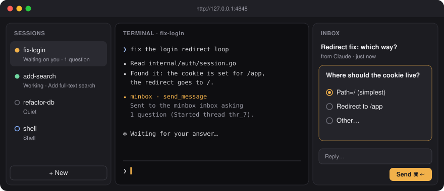
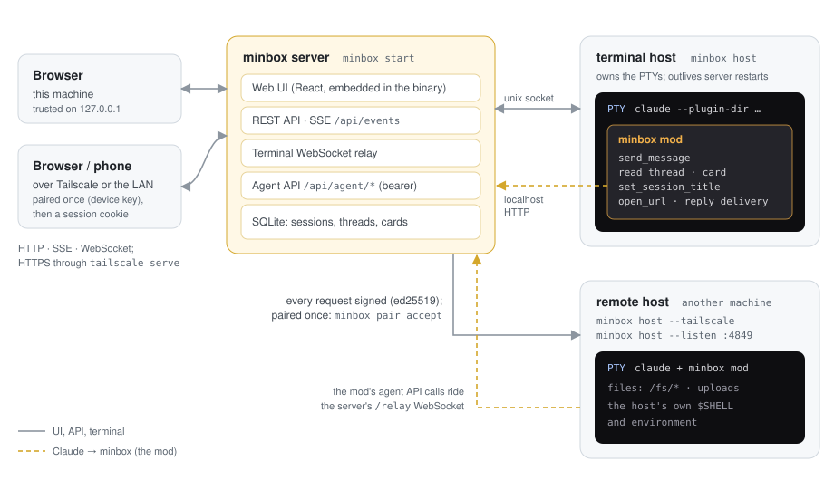
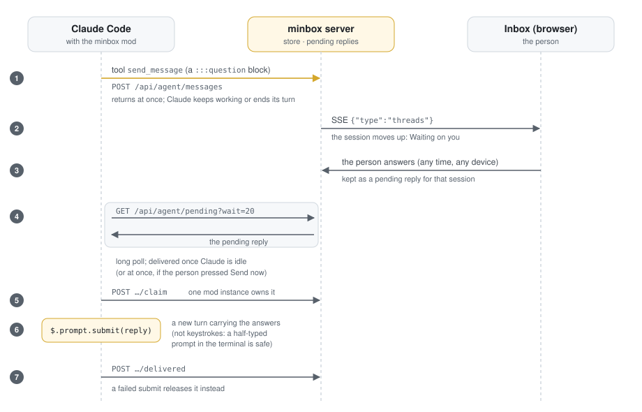

# minbox

minbox puts your Claude Code sessions, their terminals and an inbox on one screen.
Claude sends questions and reports to the inbox and keeps working; you answer when you have a
moment, from your desk or your phone, and the answer reaches Claude as a new turn.

<p align="center"></p>

- **Sessions** run in real terminals (PTYs). The list is sorted by who is waiting on whom
  (Stopped on you → Holding up work → Waiting on you → Sent → New → Quiet → Archived), and
  shows the title Claude gives each session.
- **Terminal**: the session's Claude Code in your browser (ghostty-web), clickable in its
  full-screen UI. You can type into it at any time. Paste an image with ⌘V and minbox uploads it
  and types its path.
- **Inbox**: Claude's messages, with question cards (single, multiple and free-text choice),
  action items, attachments you can annotate, and guided reviews of its changes. Your reply
  reaches Claude when it is idle. It is never typed into the terminal, so a half-typed prompt is
  safe.
- **Shells** sit next to Claude sessions: **+ New → Shell** opens the host's own `$SHELL`.
- **One binary**. The web UI, the server, the terminal host and the Claude Code mod are all in
  `minbox`, with SQLite for storage.
- **Anywhere**. Serve minbox on your tailnet and pair your phone. You can also run sessions on
  other machines (remote hosts).

minbox works with Claude Code only. It talks to Claude through a Claude Code mod (a hooks
module), not by typing into the terminal. Background and design goals: [WHAT.md](WHAT.md)
(Japanese).

## Quick start

Requirements: Go 1.26+, Node.js (to build the web UI), and Claude Code with mod support.

```sh
make build                 # builds web/dist and embeds it in bin/minbox
./bin/minbox start         # runs in the background and opens http://127.0.0.1:4848
```

Click **+ New** and pick a directory. minbox starts `claude` there with its mod loaded. When
Claude needs something from you, the session moves up the list and the question shows in the
inbox.

```sh
./bin/minbox status        # running? its URL and log (exit code 3 when stopped)
./bin/minbox restart       # stop, then start with the flags of the last `minbox start`
./bin/minbox restart --host   # also restart the local terminal host: asks first (--yes/-y skips it);
                              # sessions' claude stops and resumes (running turns are interrupted)
./bin/minbox stop          # stop the server; sessions keep running in the terminal host
./bin/minbox start --foreground   # stay in the foreground, logs on stderr
```

`start` daemonizes. It returns once the server answers, and logs go to `<data-dir>/minbox.log`.

### Flags (`minbox start`)

| Flag | Default | What it does |
| --- | --- | --- |
| `--addr` | `127.0.0.1:4848` | Address to listen on (loopback) |
| `--listen` | | Listen on another address instead, e.g. `0.0.0.0:4848`. Browsers on other machines must be paired. |
| `--data-dir` | `~/.minbox` (`MINBOX_DATA_DIR`) | Database, mod, uploads, logs |
| `--claude` | `claude` (`MINBOX_CLAUDE`) | Command that starts Claude Code, e.g. `"claude --model sonnet"` |
| `--tailscale` | | Also serve minbox on your tailnet over HTTPS (`tailscale serve`) |
| `--tailscale-service NAME` | | Serve it as the Tailscale Service `svc:NAME` instead (`https://NAME.<tailnet>.ts.net`) |
| `--tailscale-port` | `3125` | The tailnet HTTPS port |
| `--tailscale-user-login` | this machine's Tailscale user | The only Tailscale user who is answered |
| `--no-open` | | Do not open the browser |
| `--foreground` | | Do not daemonize |

## How it works

<p align="center"></p>

- **The server** (`minbox start`, Go) does the following:
  - serves the web UI, the REST API, server-sent events and the terminal WebSockets;
  - serves the agent API that the mod calls;
  - keeps sessions, threads and cards in SQLite (`modernc.org/sqlite`, no cgo).
- **The terminal host** (`minbox host`) is a separate process that owns the PTYs.
  - The server starts it when none is running.
  - Restarting or upgrading the server leaves the running sessions alone.
  - The two check each other's protocol version and restart the host only when they must.
  - After a reboot, sessions that were open resume with `claude --resume`. Sessions you stopped,
    or that Claude ended itself, stay stopped.
- **The PTY** takes the size of the smallest screen attached to it, and grows back when that
  screen leaves.
- **The minbox mod** (`plugin/minbox`) is embedded in the binary and loaded with
  `claude --plugin-dir`. It gives Claude these tools:

  | Tool | What it does |
  | --- | --- |
  | `send_message` | Send a message, `:::question` blocks, attachments or a guided review to the inbox |
  | `read_thread` | Read a thread (or list them) |
  | `set_session_title` | Set the title shown in the session list |
  | `open_url` | Open a page in your browser, wherever you are. `open URL` or `gh … --web` in Bash would open it on the host, so the mod refuses those. |
  | `card` | Create and update cards on the Board (when it is on) |

  minbox's instructions reach Claude three ways, because some environments skip one of them:
  - `--append-system-prompt`;
  - the mod's `prompt.compose` hook;
  - a reminder on the first prompt.

  They ask Claude to send every question, decision or request for action to the inbox. If a
  turn still ends with a question asked only in the chat, the mod reminds Claude once.

### A question and its answer

<p align="center"></p>

1. **Claude asks.** It calls `send_message`, which returns at once.
2. **You answer.** The inbox shows the question, and you answer it at any time, on any device.
3. **The mod waits for a quiet moment.** It long-polls for your reply and waits until Claude is
   idle (or delivers at once if you pressed *Send now*).
4. **The reply arrives once.** The mod claims the reply, submits it as a plugin turn
   (`$.prompt.submit`) and marks it delivered.
   - Claude receives the answers under "## Answers to your questions".
   - If the submit fails, the claim is released, so a reply is never lost or delivered twice.

## Notifications

**Settings → Notifications** sends every new message from Claude to a Slack channel (an
[incoming webhook](https://api.slack.com/messaging/webhooks)), with the full message text, whether or not a
browser is open. You can limit it to messages that need your answer, send only the title, and set your
Tailscale URL there so each notification has an "Open thread" link. The webhook URL stays on the server and is
never shown again in full. See `docs/api-contract.md` ("Notifications") for the format and retry rules.

## Other devices and machines

### Your phone and other browsers

```sh
minbox start --tailscale            # https://<this machine>.<tailnet>.ts.net
```

The first time a browser on another machine opens minbox, it shows a pairing code. Accept it
in one of these places:
- in a browser on this machine (**Settings → Devices**);
- with `minbox pair accept <code>`.

The browser keeps a device key, and after pairing it signs in by itself. On a phone, minbox
opens as a session list and a session view with Inbox and Terminal tabs. The terminal fits the
screen, scrolls with a swipe, and stays visible above the keyboard.

### Sessions on another machine

Run a host there and add it in **Settings → Hosts**:

```sh
minbox host --tailscale             # on the other machine: https://<it>.<tailnet>.ts.net:14849
minbox host --listen 0.0.0.0:4849   # or directly, over TCP
```

1. The server asks to pair; accept with `minbox pair accept <code>` on that machine.
2. From then on, every request the server sends to the host is signed with the server's ed25519
   key.

Sessions there run with that machine's own `$SHELL`, environment and files. Their mods reach the
server back through the same connection.

## Keyboard

Press `?` for the full list. ⌘ is Ctrl on Linux and Windows.

| Keys | |
| --- | --- |
| `⌘K` / `/` | Quick actions: type to find a session, thread or action, `↵` runs it (`>` actions, `@` sessions, `#` threads) |
| `⌘B` | Fold the session list |
| `↑` `↓` / `J` `K`, `↵` | Move, open |
| `N` / `Q` | First unread / the open question |
| `R`, `⌘↵` | Reply, send |
| `E` / `⇧E` / `Z` | Mark read / archive / undo |
| `]` `[` / `O` / `F` | Next, previous attachment / the latest / full screen |

While the terminal has focus, only `⌘K` is minbox's (Ctrl+K stays the shell's). In Claude Code's
full-screen UI, clicks and the wheel go to Claude Code; Shift+drag selects text.

## Development

```sh
make test-go        # Go unit tests
make test-mod       # the mod's tests (claude plugin test)
make test-e2e       # Playwright, against a fake claude (no model calls)
cd web && MINBOX_REAL_CLAUDE=1 npx playwright test real-claude   # a real Claude Code (Haiku)
```

For the frontend, run the server on port 4848 and `cd web && npm run dev`. Vite proxies `/api`
to the server.

Layout:

```
cmd/minbox/         CLI: start/stop/status/restart, host, pair
internal/server/    HTTP API, SSE, agent API, sessions, hosts, pairing
internal/termhost/  the terminal host (PTYs, attach protocol)
internal/store/     SQLite store
plugin/minbox/      the Claude Code mod (hooks module)
web/                React + Vite + Tailwind UI, ghostty-web terminal, Playwright tests
docs/               API contract, design notes, diagrams
```

## License

MIT. See [LICENSE](LICENSE). Parts are ported from Plannotator (MIT); see [THIRD_PARTY_NOTICES.md](THIRD_PARTY_NOTICES.md).
